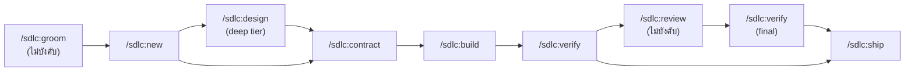

# ชุดติดตั้ง Skills สำหรับ Claude Code

> อัปเดตล่าสุด: 2026-10-20 · อ้างอิงจากโปรเจกต์ `stock-hispeed` (`skills-lock.json`, `sdlc/config.yaml`, `.claude/skills/`)

ชุดนี้ติดตั้ง skills ทั้งหมด **7 แหล่ง** ได้ด้วยสคริปต์เดียว หรือจะรันทีละคำสั่งก็ได้ ส่วน skills ในตัวของ Claude Code ไม่ต้องติดตั้งเพิ่ม

## สารบัญ

1. [ติดตั้งเร็ว](#1-ติดตั้งเร็ว)
2. [แหล่งติดตั้งและ skills ที่ได้](#2-แหล่งติดตั้งและ-skills-ที่ได้)
3. [ติดตั้งทีละขั้น](#3-ติดตั้งทีละขั้น)
4. [Skills ที่มากับ Claude Code อยู่แล้ว](#4-skills-ที่มากับ-claude-code-อยู่แล้ว)
5. [ใช้งานอย่างไร](#5-ใช้งานอย่างไร)
6. [ตรวจสอบหลังติดตั้ง](#6-ตรวจสอบหลังติดตั้ง)
7. [อัปเดตและถอนการติดตั้ง](#7-อัปเดตและถอนการติดตั้ง)
8. [ข้อควรระวัง](#8-ข้อควรระวัง)

---

## 1. ติดตั้งเร็ว

**สิ่งที่ต้องมี:** Node.js ที่ใช้ `npx` ได้, Git และ Claude Code ที่ล็อกอินแล้ว

ให้รันสคริปต์ที่ **root ของโปรเจกต์** ที่ต้องการติดตั้ง

```bash
# macOS / Linux / Git Bash
bash install.sh            # ติดตั้งลงโปรเจกต์ปัจจุบัน
bash install.sh --global   # ติดตั้งลง ~/.claude ใช้ได้ทุกโปรเจกต์
```

```powershell
# Windows PowerShell
.\install.ps1              # ติดตั้งลงโปรเจกต์ปัจจุบัน
.\install.ps1 -Global      # ติดตั้งลง ~/.claude ใช้ได้ทุกโปรเจกต์
```

สคริปต์ติดตั้ง skills ทั่วไป และ impeccable ให้แบบไม่ต้องตอบคำถาม ส่วน SDLC harness กับ claude-mem plugin ต้องมีการโต้ตอบ สคริปต์จึงจะพิมพ์คำสั่งเหล่านั้นไว้ให้รันต่อเองตอนท้าย (ดู[ขั้นที่ 3–4](#3-ติดตั้งทีละขั้น))

---

## 2. แหล่งติดตั้งและ skills ที่ได้

| # | แหล่ง | วิธีติดตั้ง | Skills ที่ได้ |
|---|---|---|---|
| 1 | [thedotmack/claude-mem](https://github.com/thedotmack/claude-mem) | `npx skills add` + plugin | 24 ตัว (ดูด้านล่าง) |
| 2 | [warnyin/warnyin-sdlc](https://github.com/warnyin/warnyin-sdlc) · npm `@warnyin/sdlc` | `npx @warnyin/sdlc init` | `sdlc:*`, `contract-writing`, `delta-spec-format`, `sdlc-conventions` และ agent `sdlc-*` |
| 3 | [pbakaus/impeccable](https://github.com/pbakaus/impeccable) · [impeccable.style](https://impeccable.style) | `npx impeccable install` | `impeccable` และ agent `impeccable-*` |
| 4 | [anthropics/skills](https://github.com/anthropics/skills) | `npx skills add` | `frontend-design` |
| 5 | [vercel-labs/agent-skills](https://github.com/vercel-labs/agent-skills) | `npx skills add` | `web-design-guidelines` |
| 6 | [vercel-labs/skills](https://github.com/vercel-labs/skills) | `npx skills add` | `find-skills` |
| 7 | [rebelytics/one-skill-to-rule-them-all](https://github.com/rebelytics/one-skill-to-rule-them-all) | `npx skills add` | `task-observer` |

<details>
<summary><b>Skills 24 ตัวจาก claude-mem</b></summary>

| หมวด | Skills |
|---|---|
| วางแผนและลงมือทำ | `make-plan`, `do`, `handoff`, `standup` |
| ทำความเข้าใจโค้ด | `smart-explore`, `learn-codebase`, `pathfinder` |
| ออกแบบ | `design-is` |
| GitHub | `babysit`, `oh-my-issues`, `version-bump` |
| Memory | `mem-search`, `knowledge-agent`, `how-it-works`, `mode-creator`, `mem-setup`, `cloud-sync`, `ccs-align`, `screenpipe` |
| รายงาน | `timeline-report`, `weekly-digests`, `Agent Cost Report` |
| อื่น ๆ | `what-the`, `wowerpoint` |

</details>

---

## 3. ติดตั้งทีละขั้น

เติม `-g` ท้ายคำสั่ง `npx skills add` ถ้าต้องการติดตั้งแบบ global

### ขั้นที่ 1 — Skills ทั่วไป

```bash
npx skills add thedotmack/claude-mem -a claude-code -y \
  --skill "Agent Cost Report" babysit ccs-align cloud-sync design-is do handoff \
          how-it-works knowledge-agent learn-codebase make-plan mem-search mem-setup \
          mode-creator oh-my-issues pathfinder screenpipe smart-explore standup \
          timeline-report version-bump weekly-digests what-the wowerpoint

npx skills add anthropics/skills                      -a claude-code -y --skill frontend-design
npx skills add vercel-labs/agent-skills               -a claude-code -y --skill web-design-guidelines
npx skills add vercel-labs/skills                     -a claude-code -y --skill find-skills
npx skills add rebelytics/one-skill-to-rule-them-all  -a claude-code -y
```

ถ้าไม่ใส่ `--skill` CLI จะให้เลือก skills เอง แต่ repo อย่าง `anthropics/skills` มีหลายสิบตัว จึงควรระบุชื่อไว้

### ขั้นที่ 2 — impeccable (ออกแบบ UI)

```bash
npx impeccable install --providers=claude --scope=project   # หรือ --scope=global
```

จากนั้นเปิด Claude Code แล้วรัน `/impeccable init` ในโปรเจกต์

### ขั้นที่ 3 — SDLC harness (ต้องตอบคำถาม)

```bash
npx @warnyin/sdlc init --tool claude
```

คำสั่งนี้จะสัมภาษณ์คุณ แล้วสร้าง `sdlc/` (constitution, harness, config) และ `.claude/` (commands, agents, skills) ให้ **รันครั้งเดียวต่อโปรเจกต์** และติดตั้งแบบ global ไม่ได้

### ขั้นที่ 4 — claude-mem plugin (worker สำหรับ memory)

Skills ในกลุ่ม Memory ต้องมี worker ของ claude-mem รันอยู่ด้วย เลือกได้หนึ่งวิธี

```bash
npx claude-mem install
```

หรือติดตั้งจากใน Claude Code

```text
/plugin marketplace add thedotmack/claude-mem
/plugin install claude-mem
```

ตัวติดตั้งจะให้ล็อกอิน claude-mem ทางเบราว์เซอร์ ถ้าไม่ต้องการล็อกอิน ให้ตั้งค่า `CLAUDE_MEM_ONLINE_OPTIN=false` ก่อนรัน

---

## 4. Skills ที่มากับ Claude Code อยู่แล้ว

Skills กลุ่มนี้มากับ Claude Code หรือบัญชี claude.ai ใช้ได้ทันทีหลังล็อกอิน

| กลุ่ม | Skills |
|---|---|
| ตรวจโค้ด | `code-review`, `simplify`, `security-review` |
| ตั้งค่า Claude Code | `update-config`, `fewer-permission-prompts`, `keybindings-help`, `init`, `plugin-authoring` |
| รันซ้ำ / ตั้งเวลา | `loop`, `schedule` |
| เปิดแอปและเบราว์เซอร์ | `run`, `claude-in-chrome` |
| หน้าเว็บและกราฟ | `artifact-design`, `artifact-diagramming`, `artifact-capabilities`, `dataviz` |
| เอกสารและไฟล์ | `anthropic-skills:docs`, `docx`, `pdf`, `pptx`, `xlsx`, `google-workspace` |
| อื่น ๆ | `claude-api`, `workflow-authoring`, `anthropic-skills:deep-research`, `skill-creator` |

---

## 5. ใช้งานอย่างไร

เริ่มทุกงานด้วย `/sdlc:next` แล้วทำตามคำสั่งที่มันแนะนำ

### เวิร์กโฟลว์ SDLC



| ขั้น | คำสั่ง | ทำอะไร |
|---|---|---|
| 0 | `/sdlc:groom` | หา requirement ที่แท้จริงก่อนเปิด change (ไม่บังคับ) |
| 1 | `/sdlc:new` | เปิด change และเลือก tier (`vibe` / `standard` / `deep`) |
| 2 | `/sdlc:design` | บันทึก design decision (สำหรับ deep tier) |
| 3 | `/sdlc:contract` | เขียน tests และ evals **ก่อน**เขียนโค้ด |
| 4 | `/sdlc:build` | implement |
| 5 | `/sdlc:verify` | รันเทสต์และให้ LM judge ให้คะแนน |
| 6 | `/sdlc:review` | review panel ด้าน security / ops / architect / quality (ไม่บังคับ) |
| 7 | `/sdlc:ship` | merge เข้า living spec, archive แล้วสรุปบทเรียน |

ถ้าอยากให้ทำทั้งหมดนี้อัตโนมัติ ใช้ `/sdlc:auto` หรือ `/sdlc:autopilot` ส่วนคำสั่งเสริมได้แก่ `/sdlc:converge` (หา drift ระหว่าง spec กับโค้ด) และ `/sdlc:observe` (ดู cost และ lead time)

### งานอื่น ๆ

| งาน | Skill ที่ใช้ |
|---|---|
| วางแผนและลงมือนอก SDLC | `/make-plan` → `/do` |
| ทำความเข้าใจโค้ด | `/smart-explore`, `/learn-codebase`, `/pathfinder` |
| ออกแบบและตรวจ UI | `/impeccable`, `/frontend-design`, `/web-design-guidelines`, `/design-is` |
| ตรวจโค้ดก่อน commit | `/code-review`, `/simplify`, `/security-review` |
| เฝ้า PR จนกว่าจะ merge ได้ | `/babysit` |
| ค้นงานและการตัดสินใจในอดีต | `/mem-search` |
| ส่งต่องานให้ session ใหม่ | `/handoff` |
| สรุปประวัติโปรเจกต์ | `/timeline-report`, `/weekly-digests` |
| หา skill ใหม่ | `/find-skills` |

---

## 6. ตรวจสอบหลังติดตั้ง

ปิดแล้วเปิด Claude Code ใหม่ จากนั้นเช็กตามนี้

- [ ] พิมพ์ `/` แล้วเห็น `sdlc:next`, `make-plan` และ `impeccable` ในรายการ
- [ ] `npx skills ls` (หรือ `npx skills ls -g`) แสดง skills จาก `npx skills add` ครบ 28 ตัว (claude-mem 24 + อีก 4 แหล่ง)
- [ ] มีไฟล์ `skills-lock.json` ที่ root ของโปรเจกต์ (เฉพาะการติดตั้งแบบโปรเจกต์)
- [ ] มีโฟลเดอร์ `sdlc/` และไฟล์ `sdlc/config.yaml`
- [ ] รัน `/sdlc:next` แล้วได้สถานะกลับมา
- [ ] รัน `/mem-search` แล้วไม่ขึ้น error ว่าเชื่อมต่อ worker ไม่ได้
- [ ] commit `skills-lock.json` ไว้ใน git เพื่อให้คนอื่นในทีมใช้เวอร์ชันเดียวกัน

---

## 7. อัปเดตและถอนการติดตั้ง

| ทำอะไร | คำสั่ง |
|---|---|
| เช็กว่ามีอัปเดตไหม | `npx skills check` |
| อัปเดต skills ทั่วไป | `npx skills update` (global: `npx skills update -g`) |
| อัปเดต SDLC harness | `npx @warnyin/sdlc update` (hook ตอนเริ่ม session จะเตือนวันละครั้งเมื่อมีเวอร์ชันใหม่) |
| อัปเดต impeccable | `npx impeccable update` |
| ถอน skill | `npx skills remove <ชื่อ skill>` (global: `--global`) |

---

## 8. ข้อควรระวัง

- **ชื่อที่มีช่องว่าง** — `Agent Cost Report` ต้องใส่เครื่องหมายคำพูดในคำสั่ง `--skill`
- **claude-mem มีสองส่วน** — `npx skills add` ติดตั้งแค่ไฟล์ skill ส่วน worker ต้องติดตั้งตาม[ขั้นที่ 4](#ขั้นที่-4--claude-mem-plugin-worker-สำหรับ-memory)
- **SDLC เป็นของแต่ละโปรเจกต์** — `init` จะเขียน constitution ตามคำตอบของคุณ ห้ามคัดลอก `sdlc/` จากโปรเจกต์อื่นมาใช้ตรง ๆ
- **impeccable ติดตั้ง hook ด้วย** — ตัวติดตั้งจะเพิ่ม hook ลงในโปรเจกต์ปัจจุบัน ถ้าใช้ Codex ร่วมด้วย ต้องอนุมัติ hook ใน `/hooks` อีกครั้ง
- **เวอร์ชันที่ใช้ตอนทำเอกสาร** — `@warnyin/sdlc` 0.24.0 · `impeccable` 4.7.0 · `skills` 1.7.4 · `claude-mem` 14.0.1
